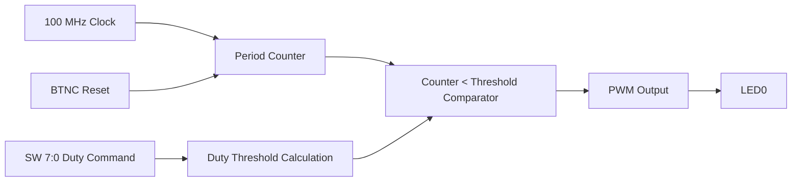

# PWM Generator — Block Diagram

## Operation

1. The 100 MHz clock drives the period counter.
2. The counter wraps after `CLOCK_HZ / PWM_FREQ_HZ` clock cycles.
3. The 8-bit switch value is scaled to a high-time threshold.
4. The comparator determines whether the PWM output is high or low.
5. The resulting 1 kHz waveform is connected to LED0.
